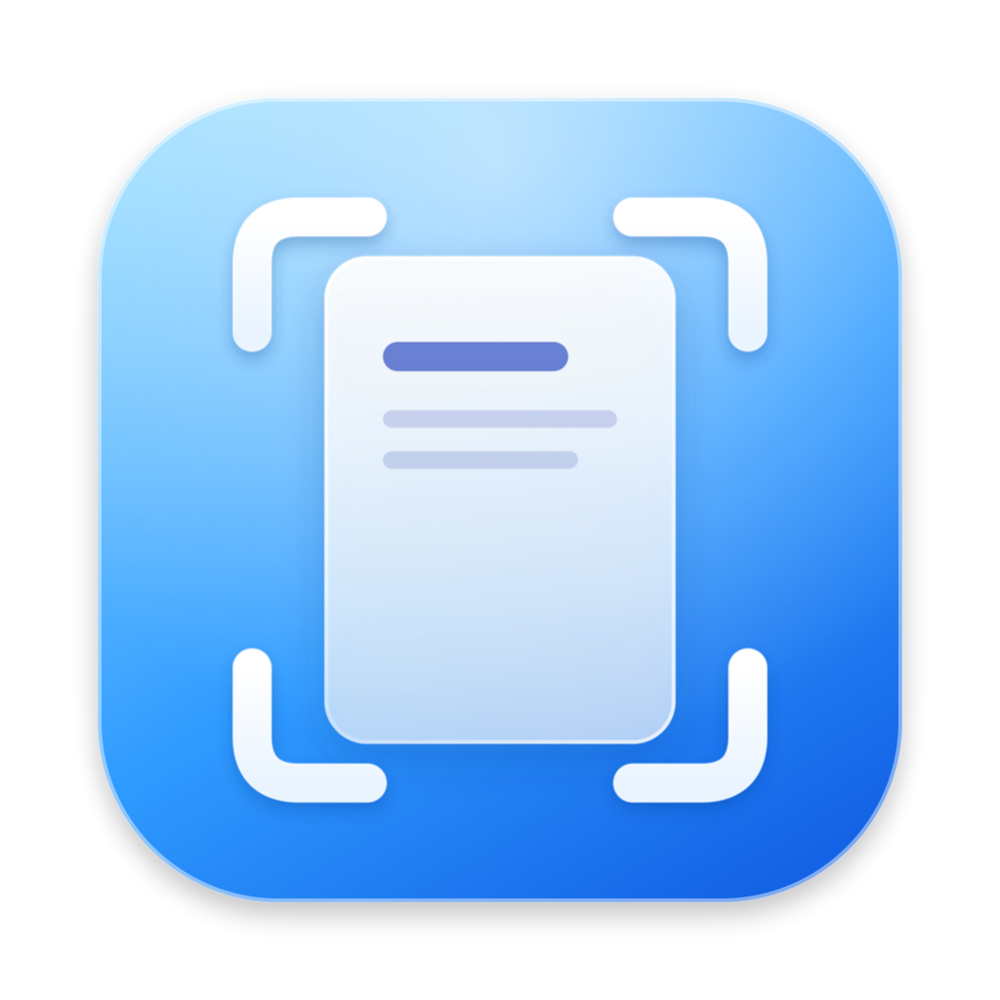
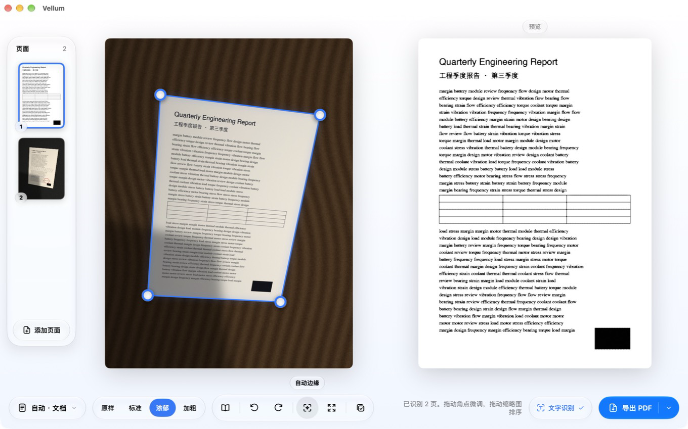

<p align="center"></p>

<h1 align="center">Vellum</h1>

<p align="center"><b>把照片变成清晰的扫描件，全部在你的 Mac 上完成。</b></p>

<p align="center">自动找边 · 透视矫正 · 文字行拉平 · 书页展平 · 去阴影 · 墨色增强 · 文字识别 · 可搜索 PDF</p>

---

## 写在前面

拍一张照片很容易，得到一份好读的扫描件却不容易：纸是斜的，光是暗的，字是淡的，书页还会弯。Vellum 想把这些麻烦都留在照片里，只把干净的一页交给你。

做 Vellum 的初衷，是摆脱扫描 App 的付费会员。导出高清要会员，文字识别要会员，合成多页 PDF 还是要会员，可这些事情一台 Mac 本来就做得到。Vellum 免费、开源，没有订阅，也没有次数限制。

“Vellum”是一种上等的书写羊皮纸，细腻、洁白，适合留下字迹。我希望它做出来的每一页，都像写在那样的纸上。

## 为什么选择 Vellum

| | |
|---|---|
| **清晰** | 原图只插值一次，笔画边缘保留细腻的灰阶过渡。文字类页面会自动提升到约 2600 像素长边，浅色笔迹会被单独加深，空心的笔画会被填实。 |
| **规整** | 找边精确到亚像素，并还原纸张的真实比例。每一行文字都会被拉成水平；开启书页展平后，书脊附近被压窄的字也会恢复原来的宽度。 |
| **干净** | 阴影和偏色会被去除，纸面变成纯白，桌面残边和细小污点会被清理掉。 |
| **可搜索** | 导出的 PDF 带有文字层，可以搜索、选中和拷贝，聚焦（Spotlight）也能找到其中的内容。 |
| **私密** | 不联网，不上传，也不需要注册账号。照片从头到尾都留在你的 Mac 上。 |
| **轻巧** | Vellum 本体约 2.6 MB，启动只需 0.2 秒，处理一页大约 0.5 秒。 |

## 开始使用

在终端中运行下面几行命令即可安装：

```bash
git clone https://github.com/ERIC1148/Vellum.git ~/Developer/Vellum
cd ~/Developer/Vellum
sh install.sh
```

安装后请保留这个文件夹，`vellum` 命令和访达快速操作都会从这里运行。

Vellum 需要 macOS 26 或更高版本，以及 Xcode 命令行工具（提供 `swiftc`，可用 `xcode-select --install` 安装）。安装程序会检查依赖、编译文字识别引擎和 Vellum.app，并在访达中加入两个快速操作。如果想卸载，运行 `sh install.sh --uninstall` 即可。

### 在访达中

在访达中选中一张或多张照片，点右键，再打开“快速操作”菜单，就能看到下面两项：

| | |
|---|---|
| **Vellum · 扫描并调整**（推荐） | 打开 Vellum 窗口。你可以确认每一页的范围、调整页面顺序、选择处理模式，看着预览满意了再导出，导出时可以选择保存位置和文件名。 |
| **Vellum · 扫描并导出 PDF** | 一步完成。Vellum 会自动处理所有照片，合成一份可搜索的 PDF，保存在第一张照片旁边。如果某一页识别不到纸张边缘，它会自动打开窗口，请你确认一下。 |

### 在 Vellum 窗口中

<p align="center"></p>

| 区域 | 你可以做什么 |
|---|---|
| **页面** | 拖动缩略图来调整顺序；把鼠标移到缩略图上可以删除这一页；点“添加页面”，或者直接把照片拖进窗口，可以继续加页。 |
| **画布** | 拖动四个蓝色角点来框选纸张。拖动时会出现一个 4 倍放大镜，方便你对准纸角。 |
| **预览** | 右侧会实时显示导出后的效果。 |
| **工具栏** | 切换处理模式和墨色，开启书页展平，旋转页面，恢复自动识别的边缘，或者改用整张照片。鼠标停在按钮上时，会显示它的名称。 |
| **导出** | 按回车键导出 PDF。点按钮右侧的箭头，还可以导出图片，或者识别文字并直接拷贝到剪贴板。 |

常用快捷键如下：`↩` 导出 PDF，`Esc` 关闭窗口，`⌘O` 添加页面，`⌘←` 和 `⌘→` 切换页面，`⌘⌫` 删除当前页。

### 在终端中

如果你习惯用命令行，Vellum 也可以直接在终端中使用：

```bash
vellum IMG_0001.HEIC                 # 生成 IMG_0001_scan.pdf（可搜索）
vellum p*.jpg -o 作业.pdf             # 把多张照片合成一份 PDF
vellum *.jpg --review                # 在 Vellum 窗口中打开
vellum 笔记.jpg -m notes              # 笔记模式：文件小，并保留彩笔颜色
vellum 书.jpg --book                  # 开启书页展平
vellum 截图.png -o 文字.txt           # 只提取文字
```

运行 `vellum -h` 可以查看全部参数。处理进度会输出到标准错误，识别出的文字会输出到标准输出，所以可以直接接到管道里使用。

## 处理模式

| 模式 | 适合什么 | 效果如何 |
|---|---|---|
| **自动** | 大多数情况 | 根据页面内容，在文档、彩色、证件与奖状之间自动选择。 |
| **文档** | 打印件、手写草稿和作业 | 纸面变成纯白，墨色加深，每一行文字被拉平。 |
| **彩色** | 带印章、彩笔批注或标志的文件 | 效果和文档模式相同，同时保留颜色。 |
| **笔记** | 手写笔记和批改过的作业 | 用少量颜色重新描绘墨迹，文件大约只有彩色模式的五分之一，红笔和蓝笔依然分明。 |
| **证件与奖状** | 证书、奖状和海报 | 保留底纹和花边，只校正光照和偏色。 |
| **演示文稿** | 对着屏幕或投影拍下的幻灯片 | 去除摩尔纹和像素网格，并对齐到 16:9。 |
| **黑白** | 只需要黑白、希望文件最小 | 输出 1 位黑白图像，并使用无损压缩。 |
| **原图** | 只想裁切矫正 | 保持原来的颜色，不做任何调色。 |

**墨色**一共有四档：原样、标准、浓郁（默认）和加粗。如果笔迹看起来偏淡，可以试试“浓郁”或“加粗”。

**书页展平**适合拍摄摊开的书。开启后，Vellum 会根据文字行推算出纸面在三维空间中的弯曲形状，再沿着这个曲面把页面展开。这样一来，弯曲的行会变直，书脊附近被压窄的字也会恢复原宽。如果拟合结果不够可靠，Vellum 会自动退回普通的拉平方式，不会把页面弄得更糟。

## 和夸克扫描王相比

| 功能 | Vellum | 夸克扫描王 |
|---|---|---|
| 自动找边、透视矫正、去阴影、画质增强 | ✓ | ✓ |
| 文字行拉平、书页三维展平 | ✓ | 部分支持 |
| 文字识别与可搜索 PDF | ✓（在本机完成） | ✓（在云端完成） |
| 多页排序并合成 PDF | ✓ | ✓ |
| 笔记调色板压缩 | ✓ | 不支持 |
| 转换为 Word 或 Excel | 不支持 | ✓ |
| 图片翻译、去水印、去手写、证件照 | 不支持 | ✓ |
| 需要联网、注册账号或上传图片 | 不需要 | 需要 |
| 在访达中右键直接处理 | ✓ | 不支持 |

Vellum 只专心做一件事：把照片变成清晰、规整、干净的扫描件。如果你需要把文件转成 Word、翻译图片里的文字或者制作证件照，夸克扫描王仍然是更合适的选择。

## 实测结果

我用合成照片检验 Vellum 的每一个环节。测试程序会先画出内容已知的原稿，再用 3D 针孔相机把它“拍”到桌面上，并加入阴影、偏色、噪声和 JPEG 压缩，最后逐项核对处理结果。运行 `python3 tests/test_synthetic.py` 就能重现。

| 场景 | 结果 |
|---|---|
| 木桌上的文档，带阴影 | 角点误差 1.3 像素，比例还原为 0.707，行倾斜为 0.00°。 |
| 浅灰桌面上的文档 | 角点误差 1.5 像素，比例还原为 0.707。 |
| 弯曲并倾斜的纸张 | 文字行的偏差从 10.8 像素降到 1.4 像素。 |
| 盖了印章的彩色文档 | 角点误差 1.5 像素，自动选择了彩色模式。 |
| 横向的证书 | 纸色还原为 (246, 238, 217)，原稿是 (246, 238, 214)。 |
| 对着屏幕拍的幻灯片 | 比例准确还原为 16:9。 |
| **摊开的书（开启书页展平）** | 刻度间距的变异系数从 0.103 降到 **0.009**；书脊附近的间距从 46.5 像素恢复到 68 像素，和页面其余部分一致。 |

同一张彩色文档用不同模式导出，文件大小如下：

| 模式 | 文件大小 |
|---|---|
| 彩色（JPEG） | 738 KB |
| 文档（灰度 JPEG） | 624 KB |
| **笔记（8 色调色板）** | **139 KB** |
| 黑白（1 位） | 59 KB |

## 技术细节

Vellum 的处理流程分为以下几个阶段：

```
detect ─▶ refine ─▶ rectify ─▶ flatten ─▶ enhance ─▶ ocr ─▶ export
```

| 阶段 | 做法 |
|---|---|
| detect | 用四种区域掩码和亮度、色度两路 Canny 边缘生成候选四边形，再按“边缘色差（设上限）× 面积平方根”打分，选出最像纸张的那一个。 |
| refine | 回到原图分辨率，沿每条边的法线采集 Lab 颜色剖面，定位到亚像素，再用 Huber 稳健拟合求出直线和交点。 |
| rectify | 用 Zhang–He 闭式解反推相机焦距和纸张的真实宽高比，再按内容吸附到标准比例。 |
| flatten | 普通模式从文字行和长横线拟合二维位移场（12 项多项式加逐行斜率网格，使用 IRLS）。书页模式改用三维三次曲面 z(u)=(α+β)u³−(2α+β)u²+αu 和针孔相机模型，用 SciPy `least_squares`（稀疏雅可比、soft-L1 损失）求解，再沿弧长展开。两种方式都和透视矫正合成一次重映射。 |
| enhance | 用形态学估计纸张底色并相除，用 MAD 估计白点，按局部抬升黑点来加深浅笔迹，用开运算填实空心笔画，最后清理污点和残边。 |
| notes | 把墨迹分成中性色和彩色两组，分别在 Lab 空间中做 k-means 聚类；调色板会加饱和、拉开深浅，索引色按 1、2 或 4 位打包。 |
| ocr | 调用 macOS Vision 识别文字（`tools/ocr.swift`），再按阅读顺序排列。 |
| export | 自己实现的 PDF 写入器：JPEG 原样嵌入，索引色和 1 位图像使用 Flate 压缩，文字层使用 Type0 字体和 fontTools 生成的无字形字体。 |
| app | 窗口使用 SwiftUI 和液态玻璃（`tools/review.swift`），界面图标是 SVG 模板图（`assets/icons/`）；图像处理通过 `vellum.py` 的 `--inspect` 和 `--plan` 完成。 |

### 借鉴的开源项目

Vellum 站在许多开源项目的肩膀上，在此向它们致谢。

| 项目 | 借鉴了什么 |
|---|---|
| [andrewdcampbell/OpenCV-Document-Scanner](https://github.com/andrewdcampbell/OpenCV-Document-Scanner) | 多候选找边，以及手动调整角点的思路。 |
| [neempata/document-scanner](https://github.com/neempata/document-scanner)、ClearPDF Local | 用背景相除去除阴影，以及按场景划分处理模式。 |
| 微软 *Whiteboard It*（Zhang 与 He） | 从透视中还原真实宽高比的方法。 |
| [mzucker/page_dewarp](https://github.com/mzucker/page_dewarp) | 用三维三次曲面描述书页弯曲的模型。 |
| [mzucker/noteshrink](https://github.com/mzucker/noteshrink) | 调色板压缩的思路。 |
| [ScanTailor Advanced](https://github.com/4lex4/scantailor-advanced) | 纠正倾斜和清除污点的做法。 |
| OCRmyPDF / Tesseract | 在 PDF 中叠加透明文字层的做法。 |

### 体积

| 组成部分 | 大小 |
|---|---|
| Vellum 本体（脚本、窗口、识别引擎和图标） | 约 2.6 MB |
| OpenCV、NumPy、Pillow 和 fontTools | 约 165 MB |
| SciPy（只有书页展平会用到，并且按需加载） | 约 91 MB |

## 已知限制

- 如果纸张和桌面的颜色几乎一样，Vellum 可能识别不到边缘。遇到这种情况，请在窗口中拖动四个角点手动框选。
- 书页展平依赖对相机焦距的估计。拍摄双页摊开的书时，建议左右两页分开拍。
- 对手写公式和手写中文，文字识别只能做到部分准确。
- 自动模式还分辨不出“对着屏幕拍的照片”，这种情况请手动选择“演示文稿”模式。

## 文件结构

```
vellum/
├── vellum.py                 全部图像算法与命令行
├── bin/vellum                命令入口
├── bin/vellum-ocr            文字识别引擎（自动编译，不纳入 git）
├── bin/Vellum.app            Vellum 窗口（自动编译，不纳入 git）
├── tools/review.swift        窗口源码（SwiftUI 与液态玻璃）
├── tools/ocr.swift           文字识别引擎源码（Vision）
├── tools/make_quick_actions.py
├── assets/icon.svg           应用图标
├── assets/icons/*.svg        界面图标（24 像素模板图）
├── tests/test_synthetic.py
└── install.sh
```

## 后记

做 Vellum 的过程中，我最常问自己的一个问题是：扫描件到底应该“像原稿”，还是应该“比原稿更好读”？最后的答案是两者都要。纸张的比例、印章的颜色、奖状的米色底纹应该忠于原稿；而笔迹的深浅、行的平直、背景的洁净，则应该比原稿更好。

如果你在使用中发现哪一页处理得不够好，最好的办法是把那张照片留下来。它很可能会成为下一个测试用例。
